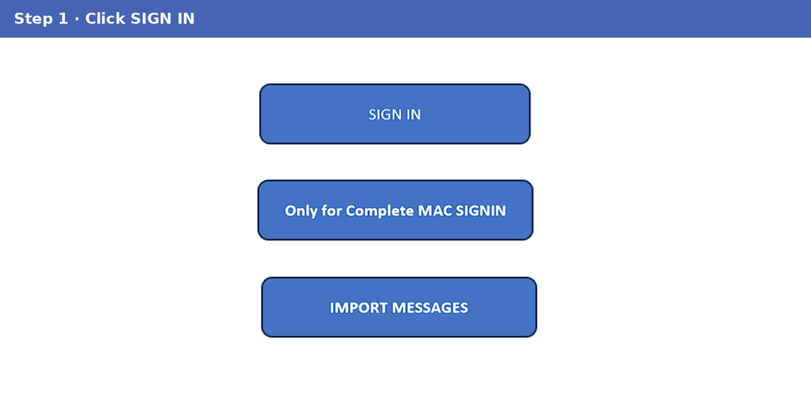
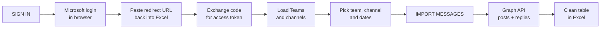
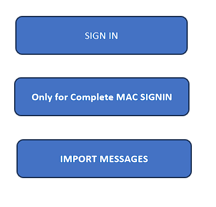
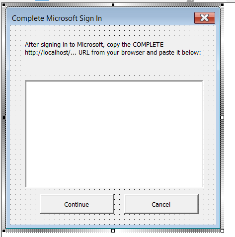
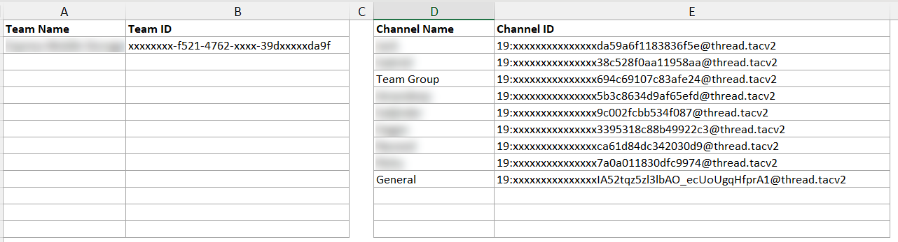
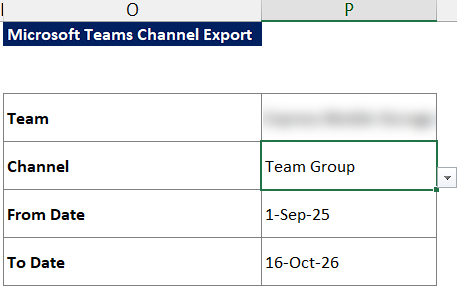
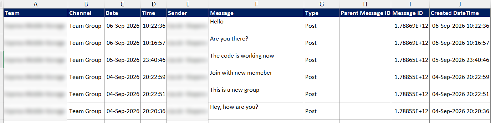

# Excel VBA Microsoft Teams Chat Extractor

### An Excel VBA tool that signs in to Microsoft 365 and pulls Microsoft Teams channel messages and replies into a clean Excel table, for any team, channel and date range, on Windows or Mac.




---

## 📑 Table of Contents

- [Project Overview](#-project-overview)
- [Business Problem](#-business-problem)
- [How It Works](#️-how-it-works)
- [Screenshots](#-screenshots)
- [Key Features & Design Decisions](#-key-features--design-decisions)
- [Technical Approach](#-technical-approach)
- [VBA Modules](#-vba-modules)
- [Setup](#-setup)
- [Repository Structure](#-repository-structure)
- [Skills Demonstrated](#-skills-demonstrated)
- [Related Project](#-related-project)
- [Credits](#-credits)
- [Contact](#-contact)

---

## 📌 Project Overview

Built for a logistics business that runs its daily operations in Microsoft Teams channels. Managers needed those conversations in Excel for reporting and record-keeping, without copying messages by hand. This tool connects Excel directly to Microsoft 365: **sign in → pick team, channel and dates → import**.

| Item | Detail |
|---|---|
| 🔐 Sign-in | Microsoft 365 account via OAuth 2.0 with PKCE (no password stored in Excel) |
| 🌐 Data source | Microsoft Graph API (v1.0) |
| 💬 Data pulled | Channel posts **and** their replies, with HTML cleaned to plain text |
| 🎛️ Filters | Team, channel, from date, to date |
| 📤 Output | 10-column table: team, channel, date, time, sender, message, type, parent ID, message ID, created time |
| 💻 Platforms | Excel for Windows and Excel for Mac |

> **Note:** this is a demo version. No credentials are included, and screenshots have names blurred.

---

## 🎯 Business Problem

Important instructions, updates and decisions were spread across many Teams channels. Getting them into a report meant scrolling and copy-pasting, which was slow and missed replies.

**What the tool answers:**

1. What was said in a given **channel** between two **dates**?
2. **Who** said it, and **when** exactly?
3. Which messages were **replies**, and to which post?
4. Can this data go straight into a report or an **AI summary**? (Yes: see the [related project](#-related-project).)

---

## ⚙️ How It Works



1. Click **SIGN IN**. The Microsoft login page opens in the browser.
2. After signing in, copy the `http://localhost/...` address and paste it into the Excel form.
3. VBA exchanges the code for an access token (PKCE protects this step) and loads your Teams.
4. Pick a **Team**. Its channels load into the next dropdown automatically.
5. Choose **Channel**, **From Date** and **To Date**, then click **IMPORT MESSAGES**.
6. VBA calls the Graph API page by page, collects posts and replies, cleans the text and writes the table.

**On Mac:** after step 2, paste the URL into the sheet and click **Only for Complete MAC SIGNIN**.

---

## 🖼️ Screenshots

### 1️⃣ Buttons and sign-in

| Buttons | Sign-in form |
|---|---|
|  |  |

### 2️⃣ Teams and channels loaded from Microsoft 365



### 3️⃣ Selection



### 4️⃣ Output



---

## ✨ Key Features & Design Decisions

| Feature | Why |
|---|---|
| 🔐 **OAuth 2.0 with PKCE** | The secure, recommended sign-in for desktop apps. No client secret and no password in the workbook |
| 🔄 **Automatic token refresh** | When the access token expires, the tool refreshes it silently instead of asking the user to sign in again |
| 🧵 **Posts and replies** | Replies are pulled with each post and linked by Parent Message ID, so whole conversations are kept |
| 📄 **Paging** | Follows Graph's `nextLink` until every message in the date range is collected |
| 🧹 **HTML cleaning** | Teams stores messages as HTML; the tool converts them to readable text |
| 🎛️ **Dependent dropdowns** | Picking a team reloads its channel list automatically |
| ✅ **Input checks** | Clear messages for missing team, channel or invalid dates |
| 🍎 **Windows and Mac** | Separate HTTP and sign-in paths chosen at runtime |

---

## 🧮 Technical Approach

| Area | What was built |
|---|---|
| **Authentication** | Authorization-code flow with PKCE: random verifier, SHA-256 challenge, Base64URL encoding and `state` check, all in VBA |
| **Token handling** | Code-for-token exchange, refresh-token flow and reuse across calls |
| **Graph API calls** | `me/joinedTeams`, team channels, channel messages with `$expand=replies`, and reply paging |
| **HTTP** | Windows and Mac implementations behind one `HttpGet` / `HttpPost` interface |
| **JSON** | Responses parsed with VBA-JSON; VBA-Dictionary keeps it working on Mac |
| **Excel UX** | Buttons, a sign-in UserForm, data-validation dropdowns and a worksheet event that refreshes channels |

---

## 🧩 VBA Modules

| File | Purpose |
|---|---|
| [`vba/Microsoft_Signin.bas`](vba/Microsoft_Signin.bas) | All main logic: sign-in, PKCE, tokens, Graph calls, loading teams and channels, importing messages and replies |
| `frmMicrosoftLogin` (in workbook) | Form where the user pastes the redirect URL after signing in |
| `Messages` sheet code (in workbook) | Reloads the channel list when the team changes |
| [`vba/third-party/JsonConverter.bas`](vba/third-party/JsonConverter.bas) | VBA-JSON by Tim Hall (MIT) |
| [`vba/third-party/Dictionary.cls`](vba/third-party/Dictionary.cls) | VBA-Dictionary by Tim Hall (MIT), needed on Mac |

---

## 🚀 Setup

1. **Register an app** in Microsoft Entra ID (Azure portal):
   - Platform: *Mobile and desktop applications*, redirect URI `http://localhost`
   - Delegated permissions: `Team.ReadBasic.All`, `Channel.ReadBasic.All`, `ChannelMessage.Read.All`, `offline_access`
2. Download [`workbook/Excel_Microsoft_Teams_Chat_Summarizer_Demo.xlsm`](workbook/Excel_Microsoft_Teams_Chat_Summarizer_Demo.xlsm) and enable macros.
3. Open the VBA editor (Alt + F11 on Windows, Option + F11 on Mac).
4. In `Microsoft_Signin`, replace `YOUR_CLIENT_ID` and `YOUR_TENANT_ID` with your app's values.
5. Click **SIGN IN**, then pick team, channel and dates, then **IMPORT MESSAGES**.

> `ChannelMessage.Read.All` usually needs admin consent from your Microsoft 365 admin.

---

## 📁 Repository Structure

```
📦 excel-vba-teams-chat-extractor
 ┣ 📜 README.md
 ┣ 📂 workbook
 ┃ ┗ 📗 Excel_Microsoft_Teams_Chat_Summarizer_Demo.xlsm   # Demo workbook (no credentials)
 ┣ 📂 vba
 ┃ ┣ 📄 Microsoft_Signin.bas                             # Main module
 ┃ ┗ 📂 third-party
 ┃   ┣ 📄 JsonConverter.bas                              # VBA-JSON (MIT)
 ┃   ┣ 📄 Dictionary.cls                                 # VBA-Dictionary (MIT)
 ┃   ┣ 📄 LICENSE-VBA-JSON.txt
 ┃   ┗ 📄 LICENSE-VBA-Dictionary.txt
 ┗ 📂 images
   ┣ 🎞️ demo.gif
   ┣ 🖼️ 01_buttons.png
   ┣ 🖼️ 02_signin_form.png
   ┣ 🖼️ 03_teams_channels.png
   ┣ 🖼️ 04_user_selection.png
   ┗ 🖼️ 05_output.png
```

---

## 🧠 Skills Demonstrated

- **API integration from Excel**: Microsoft Graph REST calls with paging and nested data
- **Security**: OAuth 2.0 authorization-code flow with PKCE and token refresh, written in VBA
- **Cross-platform VBA**: one workbook that runs on Windows and Mac
- **Data cleaning**: HTML to text, ISO dates to Excel dates, posts linked to replies
- **Excel UX**: buttons, UserForm, dependent dropdowns, input validation

---

## 🔗 Related Project

Turn the extracted chats into structured insights with Generative AI: [Excel AI Chat Insights](https://github.com/mdatafinnovatics/excel-ai-chat-insights)

---

## 🙏 Credits

JSON parsing uses [VBA-JSON](https://github.com/VBA-tools/VBA-JSON) and Mac dictionary support uses [VBA-Dictionary](https://github.com/VBA-tools/VBA-Dictionary), both by Tim Hall under the MIT licence. Their licence files are in `vba/third-party/`.

---

## 📬 Contact

**Pradeep Kumar** | Founder, Mdata Finnovatics | Excel VBA, Power BI & AI Automation Consultant

[](https://mdatafinnovatics.com)
[](https://www.linkedin.com/in/pradeepkumar777)

---

⭐ **If you found this project useful, please give it a star!** ⭐
